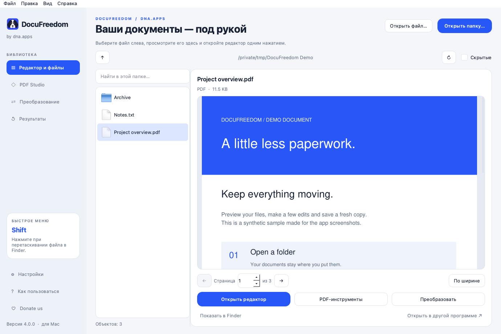
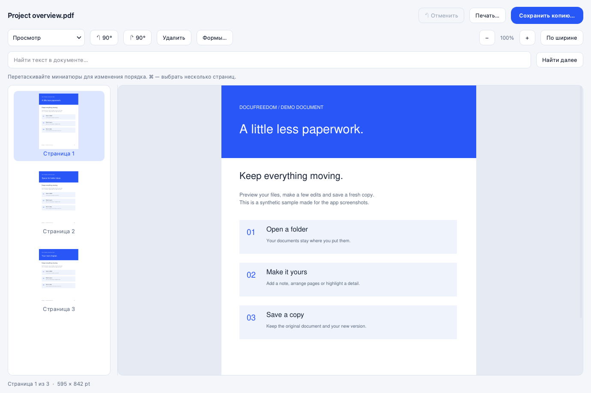
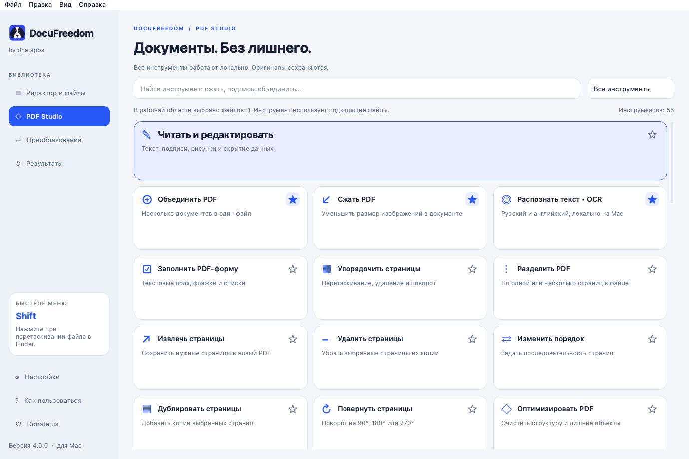
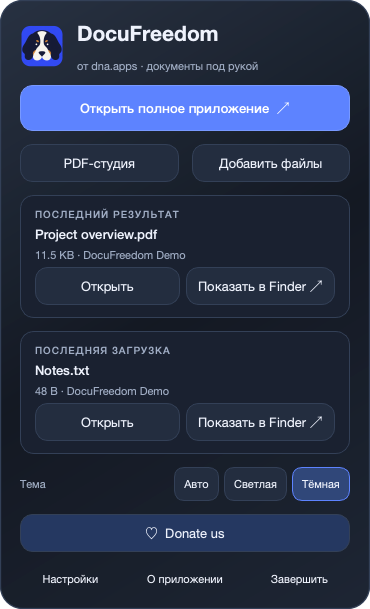

<div align="center">
  
  <h1>DocuFreedom</h1>
  <p><strong>Your documents. Your Mac. Your freedom.</strong><br>Published by <strong>dna.apps</strong></p>
  <p>A local document workspace with a PDF editor, folder previews, pinned tools, OCR, and a menu-bar companion.</p>
  <p><a href="https://github.com/NikkiIMOEX5000/DocuFreedom/releases">Download for macOS</a> · <a href="docs/FEATURES-RU.md">Feature guide (Russian)</a> · <a href="CONTRIBUTING.md">Contribute</a></p>
</div>

## Meet DocuFreedom

Open a folder, preview a file, and start editing. Keep your most-used PDF tools pinned near the top. Switch between light, dark, and system appearance. Close the main window and keep working from a small companion in the macOS menu bar.

The mascot is a simplified portrait of the creator's dog. The interface pairs cobalt accents with warm light surfaces or a deep charcoal dark theme. **dna.apps is the publisher; DocuFreedom is the application.**

<picture>
  <source media="(prefers-color-scheme: dark)" srcset="docs/screenshots/workspace-dark.png">
  
</picture>

<details>
<summary>Explore the PDF editor, pinned tools and menu-bar companion</summary>






</details>

## What you can do

- **Browse and preview:** navigate local folders, search the current folder, preview PDFs and images, and read text previews of supported Office documents. Edit PDFs and images, save text edits as a copy, or convert Office documents to PDF for editing.
- **Edit PDFs:** page thumbnails, reordering, rotation, deletion, text, highlights, images, drawn signatures, real content redaction, form filling, search, undo, and save-copy.
- **Pin your tools:** star frequent actions and keep them at the front of the PDF tool catalog.
- **Transform documents:** merge, split, extract, duplicate, crop, resize, watermark, number pages, overlay, create booklets, and arrange several pages on one sheet.
- **Protect and inspect:** AES-256 passwords, metadata, attachments, visual comparison, structural repair, local P12/PFX signing, and offline signature integrity reports.
- **Convert and recognize:** PDF/image/text conversions, DOCX/XLSX/PPTX/ODT-to-PDF export with bundled LibreOffice, PDF-to-PowerPoint/Excel/SVG/HTML/TIFF, and on-device English/Russian OCR with Apple Vision.
- **Prepare output:** compression, real web linearization, PDF/A-2b with local validation, PDF/X-3 with ICC profiles, system printing, screen-region capture, and Image Capture scanner integration.
- **Stay close to your files:** the menu-bar panel shows the latest result and latest file in Downloads (temporary download files are excluded), with buttons to open them or reveal their exact location in Finder.

Processing runs locally. The webpage-to-PDF tool fetches only the URL you explicitly enter. There is no application account, subscription, telemetry, or automatic upload of your documents.

## Install

**Apple Silicon · macOS 15 or later**

1. Download the latest `.dmg` from [Releases](https://github.com/NikkiIMOEX5000/DocuFreedom/releases).
2. Open it and drag **DocuFreedom.app** into **Applications**.
3. Launch DocuFreedom. Find its minimal dog-outline icon in the macOS menu bar, or launch it again from Spotlight to open the full workspace.

The app runs without a Dock icon. Closing a window keeps the menu-bar companion running; use **Quit** to exit. Start at login is optional. Python, Homebrew, and separate LibreOffice or Ghostscript installations are not required to run the packaged app.

The current build is **ad-hoc signed, not Apple notarized**. If macOS blocks a downloaded copy, follow the standard **System Settings → Privacy & Security → Open Anyway** flow after attempting to open it. We do not ask you to disable Gatekeeper.

On a crowded menu bar, macOS may place third-party icons behind the camera notch. Relaunching from Spotlight opens the workspace even when the icon is not visible. You can also rearrange menu-bar items with Command-drag.

## Accuracy and scope

DocuFreedom is a standalone macOS application, not an official PDF24 or Drinkit product.

- Office-to-PDF export uses bundled LibreOffice to render document styles, page sizes, margins, sections, tables, headers, and footers. Missing fonts and differences between LibreOffice and Microsoft Office can still change line breaks or complex elements. For the closest result, install the fonts used by the source document.
- The Office preview in the folder browser shows extracted text, not page layout. Use **Create PDF and edit** to see the converted pages.
- PDF-to-Word reconstructs editable text and images from a PDF; complex layout and tables may differ. This reverse conversion does not use the Office-to-PDF renderer.
- PDF-to-PowerPoint creates image-based slides; PDF-to-Excel extracts detected tables. It does not reconstruct an arbitrary spreadsheet.
- OCR quality depends on the scan. HTML rendering is static and does not execute JavaScript.
- Drawn signatures are visual marks. Certificate signing is separate; offline validation checks integrity and document coverage, not certificate trust, revocation, legal validity, or a trusted timestamp.
- PDF/A export includes local pikepdf validation. PDF/X uses strict Ghostscript export and structural checks. Neither is a substitute for an independent archival validator or a print shop's preflight.
- Scanner and printer integrations require compatible hardware. Physical scanning and printing are not covered by the automated suite.
- Image/PDF editors preserve source files by saving copies. Large PDF previews are bounded to keep memory use reasonable.

See the [feature guide](docs/FEATURES-RU.md) and [test report](docs/TEST-REPORT.md) for details.

## Build from source

```bash
git clone https://github.com/NikkiIMOEX5000/DocuFreedom.git
cd DocuFreedom
./build-mac.command
```

Building requires **Python 3.14**, **Xcode Command Line Tools**, and an Apple Silicon Mac. The script creates `.venv`, installs `requirements-macos.lock`, prepares checksum-verified Ghostscript and LibreOffice runtimes if needed, runs tests, packages the app, checks its signature, smoke-tests the frozen bundle, and creates the disk image.

```bash
QT_QPA_PLATFORM=offscreen .venv/bin/python -m pytest -q
QT_QPA_PLATFORM=offscreen .venv/bin/python run.py --selftest
```

Output: `dist/DocuFreedom.app` and `dist/DocuFreedom-4.1.0-mac-arm64.dmg`.
The internal Python package remains named `dragshift` to keep the upstream code lineage clear. Existing DragShift settings are read for migration; new settings belong to DocuFreedom.

## A special thank-you

**Thank you, [llamaboi55](https://github.com/llamaboi55), for [DragShift](https://github.com/llamaboi55/DragShift).** I came across a link to DragShift on Instagram, was inspired by its approach, and wanted to take the idea further into a document workspace for my Mac.

DocuFreedom builds on DragShift's code and its Shift-drag radial workflow. This is an independent continuation by dna.apps, not an official release or endorsement by the original author. The original MIT attribution is preserved in [licenses/DragShift-MIT.txt](licenses/DragShift-MIT.txt). See [CREDITS.md](CREDITS.md) for the components that make this project possible.

## License

DocuFreedom is distributed under **AGPL-3.0-or-later**; see [LICENSE](LICENSE). Upstream DragShift retains its MIT notice. Included libraries and artwork retain their applicable notices. See [THIRD-PARTY-NOTICES.md](THIRD-PARTY-NOTICES.md) and [dependency source information](docs/DEPENDENCY-SOURCES.md).

## Support

All tools are available without payment. The optional **Donate us** panel uses the support address supplied by the project owner:

`TNHazdSaijRvjL9YL3oy8widVkaNdf6SFw`

No payment is made by the app, and it does not infer a cryptocurrency or network from this address.
